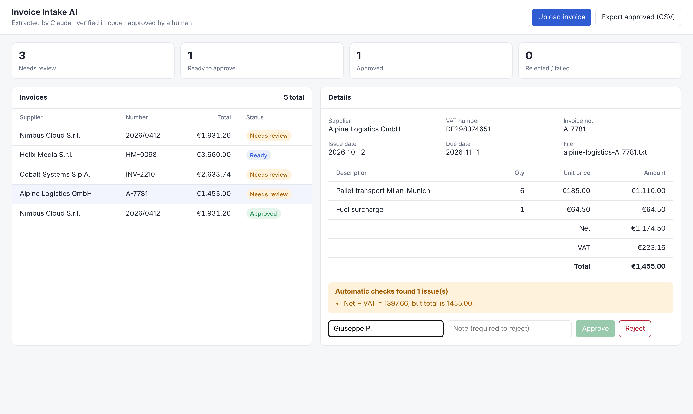

# Invoice Intake AI

Supplier invoices in, verified accounting data out.
**Claude extracts** the data, **code verifies** it, **a human approves** it.



Demo project for an accounts-payable workflow: upload a PDF or text invoice, the Claude API returns structured data (supplier, VAT number, dates, line items, totals), deterministic checks catch arithmetic errors, duplicates and missing data, and a reviewer approves or rejects each invoice from a small dashboard. Approved invoices are exported as CSV for the accounting system.

## Design choices

**Structured output, not free text.** The model is forced to call a `record_invoice` tool whose input schema is generated from the Pydantic model. The response is always JSON and is validated before it reaches the database.

**Never trust the model with arithmetic.** Every invoice goes through checks written in plain code:

| Check | Example |
|---|---|
| Line arithmetic | quantity × unit price ≠ line amount |
| Sum of lines vs net amount | lines add up to 1,174.50 but net says 1,200.00 |
| Net + VAT vs total | the printed total contains an error |
| Plausible VAT rate | 18.2% is not a valid EU rate |
| Dates | due date before the issue date |
| Required data | supplier VAT number missing |
| Duplicates | same supplier and invoice number already registered |

**Human in the loop.** Nothing is approved automatically. Invoices with open issues cannot be approved until a reviewer corrects the data (checks run again) or rejects the invoice with a note. Closed invoices are immutable, and every decision records who made it.

**Thin AI layer.** The extractor sits behind a small `Extractor` protocol, so it can be replaced (another model, a local OCR pipeline) without touching the workflow, and the whole application is tested without network calls.

## Architecture

```
          upload (PDF/TXT)
                 │
   ┌─────────────▼─────────────┐
   │ text_extraction (pypdf)   │
   └─────────────┬─────────────┘
                 │ text
   ┌─────────────▼─────────────┐      forced tool call       ┌────────────┐
   │ ClaudeExtractor           │ ──────────────────────────▶ │ Claude API │
   └─────────────┬─────────────┘ ◀── JSON (schema-checked) ─ └────────────┘
                 │ InvoiceData
   ┌─────────────▼─────────────┐
   │ checks (deterministic)    │ ──▶ needs_review / ready_for_approval
   └─────────────┬─────────────┘
                 │
   ┌─────────────▼─────────────┐
   │ review workflow + SQLite  │ ──▶ approved / rejected ──▶ CSV export
   └───────────────────────────┘
```

## REST API

| Method | Path | Description |
|---|---|---|
| `POST` | `/api/invoices` | Upload a PDF/TXT invoice (multipart `file`) |
| `GET` | `/api/invoices?status=` | List invoices, optionally by status |
| `GET` | `/api/invoices/{id}` | Invoice details, extracted data and issues |
| `PUT` | `/api/invoices/{id}/data` | Reviewer correction; checks run again |
| `POST` | `/api/invoices/{id}/approve` | Approve (only when no issues are open) |
| `POST` | `/api/invoices/{id}/reject` | Reject (note required) |
| `GET` | `/api/invoices/export.csv` | Approved invoices for the accounting system |

Interactive OpenAPI docs are served at `/docs`.

## Run it

Requires Python 3.11+.

```bash
pip install -e ".[dev]"
pytest                                   # 20 tests, no API key needed
```

**Offline demo** (sample invoices from `samples/`, no API key):

```bash
invoice-intake-demo                      # http://127.0.0.1:8000
```

**With Claude:**

```bash
export ANTHROPIC_API_KEY=sk-ant-...
export CLAUDE_MODEL=claude-sonnet-4-5    # any current Claude model
invoice-intake                           # http://127.0.0.1:8000
```

## Production notes

- Swap SQLite for PostgreSQL and add authentication (the reviewer name is free text in the demo).
- Scanned invoices need an OCR step before extraction (or send the PDF to Claude as a document block).
- Send approved invoices to the ERP through its API instead of CSV.

## Tech

Python, FastAPI, Pydantic v2, Anthropic Python SDK (tool use), pypdf, SQLite, vanilla JS dashboard, pytest.

## License

MIT
